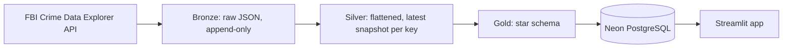

# FBI Crime Data Pipeline and Dashboard

An end-to-end data engineering project: a bronze/silver/gold pipeline that pulls state-level crime statistics from the FBI Crime Data Explorer API into PostgreSQL, and a public Streamlit dashboard for comparing states and offenses.

**Live app:** [https://fbi-crime-dexp.streamlit.app/]


## What it does

- Extracts agency lists and monthly offense counts for **California, Texas, Wyoming and Vermont**, from **January 2020 to January 2026**.
- Cleans and models the data in layers, ending in a star schema.
- Serves an interactive dashboard: compare states or offenses, pick individual years or months, see annualised rates per 100,000 people, clearance rates, and each state against the average of its peers.

## Architecture




| Layer | What it holds |
|---|---|
| Bronze | The API responses exactly as received. Every run appends new rows and nothing is overwritten. |
| Silver | Flattened tables built from the latest successful snapshot per state and offense, loaded with idempotent upserts. |
| Gold | Star schema: `gold_offense_facts` plus the `gold_dim_state`, `gold_dim_offense` and `gold_dim_agency` dimensions. |

## Data quality

`tests/test_dq.py` runs 11 pytest checks across the layers: all four states landed, every API call succeeded, no duplicate agency codes, row counts match between silver and gold, no orphaned foreign keys, and no negative counts or clearance rates.

## Tech stack

Python, SQLAlchemy, PostgreSQL, pandas, Altair, Streamlit. Hosted on Neon (database) and Streamlit Community Cloud (app).

## From MySQL to PostgreSQL

The pipeline was originally built on MySQL and then migrated. The main differences I handled:

| MySQL | PostgreSQL |
|---|---|
| `ON DUPLICATE KEY UPDATE` | `ON CONFLICT (...) DO UPDATE` with `EXCLUDED` |
| `AUTO_INCREMENT` | `GENERATED ALWAYS AS IDENTITY` |
| `LONGTEXT` | `TEXT` |
| Division always returns a decimal | Integer division truncates, so `::numeric` casts are needed |
| Division by zero returns `NULL` | Division by zero raises an error, so `NULLIF` is needed |
| A failed statement leaves the session usable | A failed statement aborts the transaction until `rollback()` |
| Index names are unique per table | Constraint names must be unique across the schema |

## Run it locally

```bash
python -m venv .venv
.venv\Scripts\activate    
pip install -r requirements.txt
```

Create a `.env` file:

```
FBI_API_KEY=your_key
FBI_API_BASE=https://api.usa.gov/crime/fbi/cde
STATES=CA,TX,WY,VT
POSTGRES_HOST=localhost
POSTGRES_PORT=5432
POSTGRES_USER=postgres
POSTGRES_PASSWORD=your_password
POSTGRES_DATABASE=fbi_crime
```

Create the tables, run the pipeline, and test it:

```bash
psql -U postgres -d fbi_crime -f schema.sql
python scripts/run_pipeline.py
pytest tests/ -v
psql -U postgres -d fbi_crime -f scripts/views.sql
```

Start the dashboard:

```bash
streamlit run app/web_app.py
```

## Deployment

The gold tables and views are copied to a Neon project with `pg_dump` and `psql`. The app connects through a read-only database role. Its connection string is stored as a `DATABASE_URL` secret on Streamlit Community Cloud and is never committed to the repo.

## Notes on the data

- 2021 is excluded by default because it is a reported anomaly year in the source data. A checkbox adds it back.
- Rates are annualised: total offenses divided by total population, times 100,000, times 12 (so they are valid for any selection of months).
- Data source: [FBI Crime Data Explorer](https://cde.ucr.cjis.gov/). This project is not affiliated with the FBI.

## Project structure

```
app/          Streamlit app and query layer
config/       Database connection
scripts/      Pipeline scripts and views.sql
tests/        Data quality tests
data/         schema.sql, views.sql, reset_schema.sql
```

## Author

Desmond Boako Obeng, BSc Data Science student at Ghana Communication Technology University, working towards data engineering.
[GitHub](https://github.com/donyb6) · obengdboako@gmail.com