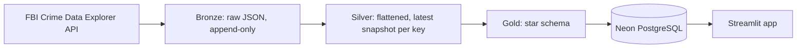

# FBI Crime Data Pipeline and Dashboard

An end-to-end data engineering project: a bronze/silver/gold pipeline that pulls state-level crime statistics from the FBI Crime Data Explorer API into PostgreSQL, and a public Streamlit dashboard for comparing states and offenses.

**Live app:** [https://fbi-crime-dexp.streamlit.app/]

## What it does

- Extracts agency lists and monthly offense counts for **California, Texas, Wyoming and Vermont**, from **January 2020 to January 2026**.
- Cleans and models the data in layers, ending in a star schema.
- Serves an interactive dashboard: compare states or offenses, pick individual years or months, see annualised rates per 100,000 people, clearance rates, and each state against the average of its peers.

## Architecture

| Layer | What it holds |
|---|---|
| Bronze | The API responses exactly as received. Every run appends new rows and nothing is overwritten. |
| Silver | Flattened tables built from the latest successful snapshot per state and offense, loaded with idempotent upserts. |
| Gold | Star schema: `gold_offense_facts` plus the `gold_dim_state`, `gold_dim_offense` and `gold_dim_agency` dimensions. |

## Data quality

`tests/test_dq.py` runs 11 pytest checks across the layers: all four states landed, every API call succeeded, no duplicate agency codes, row counts match between silver and gold, no orphaned foreign keys, and no negative counts or clearance rates.

## Tech stack

Python, SQLAlchemy, PostgreSQL, pandas, Altair, Streamlit. Hosted on Neon (database) and Streamlit Community Cloud (app).
