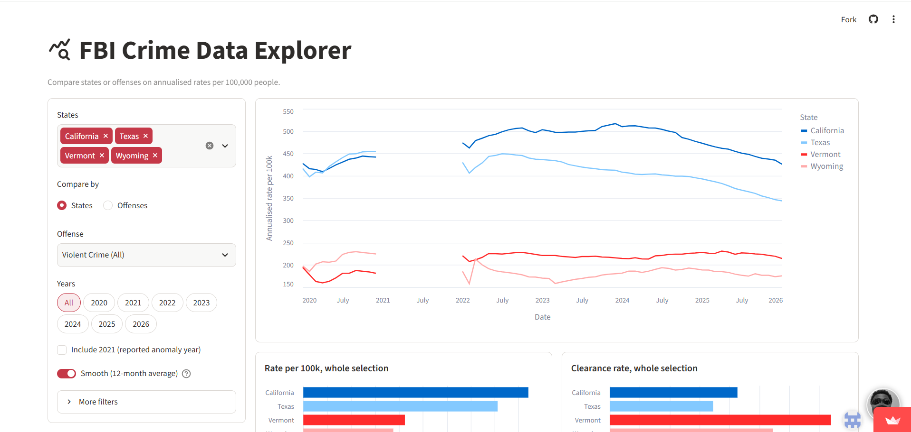

# FBI Crime Data Pipeline and Dashboard

An end-to-end data engineering project: a bronze/silver/gold pipeline that pulls state-level crime statistics from the FBI Crime Data Explorer API into PostgreSQL, and a public Streamlit dashboard for comparing states and offenses.

**Live app:** [https://fbi-crime-dexp.streamlit.app/]

